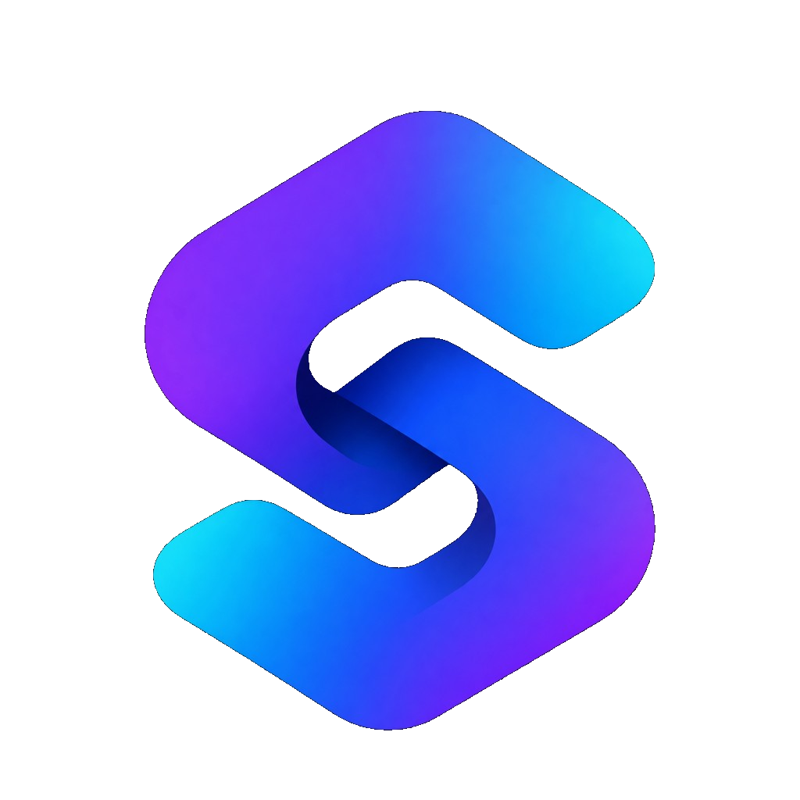

<p align="center">
  
</p>

<h1 align="center">Syncra</h1>

<p align="center">
  A shared workspace for a student team.<br />
  Plan a project on a board, talk on the task, and see which card a teammate is on.
</p>

<p align="center">
  <a href="https://syncra-frontend.deeprajb012.workers.dev"></a>
  &nbsp;
  <a href="https://syncra-backend-zj6t.onrender.com"></a>
</p>

<p align="center">
  <a href="https://syncra-frontend.deeprajb012.workers.dev"><code>syncra-frontend.deeprajb012.workers.dev</code></a>
  ·
  <a href="https://syncra-backend-zj6t.onrender.com"><code>syncra-backend-zj6t.onrender.com</code></a>
  ·
  <a href="https://syncra-backend-zj6t.onrender.com/docs">API docs</a>
</p>

Syncra is a real-time project space for a class, a group, or one piece of work. A workspace holds the team and its projects. Each project is a board with four columns: To do, In progress, Review, and Done. Cards carry a priority, a due date, and an assignee. Comments, activity, and notifications stay on the work they belong to. A live mark shows who else is in the workspace, and a chip shows which card or column they are on.

This repository ties the two services together. The product itself lives in the submodules.

| | | |
| --- | --- | --- |
| **App** | [syncra-frontend](syncra-frontend/README.md) | Next.js on Cloudflare |
| **API** | [syncra-backend](syncra-backend/README.md) | FastAPI on Render |

## The app

The site is live at [syncra-frontend.deeprajb012.workers.dev](https://syncra-frontend.deeprajb012.workers.dev). The home page, Features, and How it works are public. The dashboard requires a sign-in.

A workspace is the home for one team. Owners and admins look after it. Members do the work. Viewers can follow the board and read the discussion. Invite links land on the app, and archiving hides the workspace for every member.

On a project, drag a card into the column that matches where the work is. Filter by assignee or priority, or search by title. Open a card for the description, the schedule, the activity on that task, and the comments. The author can edit their own comment. The author, an owner, or an admin can delete one.

The bell is for work that involves you: an assignment, or a comment on a task you are assigned to or have already talked on. Opening a notification marks it read and takes you to that task. You do not get a notification for something you just did yourself.

The pictures of the signed-in product, and how to run the app locally, are in the [frontend README](syncra-frontend/README.md).

## The API

The API is live at [syncra-backend-zj6t.onrender.com](https://syncra-backend-zj6t.onrender.com). Interactive docs are at [/docs](https://syncra-backend-zj6t.onrender.com/docs).

It stores workspaces, projects, tasks, comments, activity, and notifications in MongoDB, checks Auth0 access tokens, and pushes live updates over a workspace WebSocket. REST is the source of truth. The socket tells connected clients that something changed. A missed event is recovered by refetching, not by replaying a backlog.

Roles, the route list, the socket protocol, configuration, and the test command are in the [backend README](syncra-backend/README.md).

## Stack

| | App | API |
| --- | --- | --- |
| Runtime | Next.js 16, React 19 | Python 3.9+, FastAPI |
| Sign-in | Auth0 | Auth0 RS256 access tokens |
| Data | TanStack Query | MongoDB |
| Live updates | Workspace socket | In-process WebSocket registry |
| Host | Cloudflare, via OpenNext | Render |

## Clone

```bash
git clone --recurse-submodules https://github.com/DeeprajB/syncra.git
cd syncra
```

If the clone is already on disk without the submodules:

```bash
git submodule update --init --recursive
```

Then follow [syncra-frontend/README.md](syncra-frontend/README.md) and [syncra-backend/README.md](syncra-backend/README.md). The app expects the API origin in `NEXT_PUBLIC_API_URL`. The API expects the app origin in `APP_BASE_URL`.

## License

[MIT](LICENSE)
